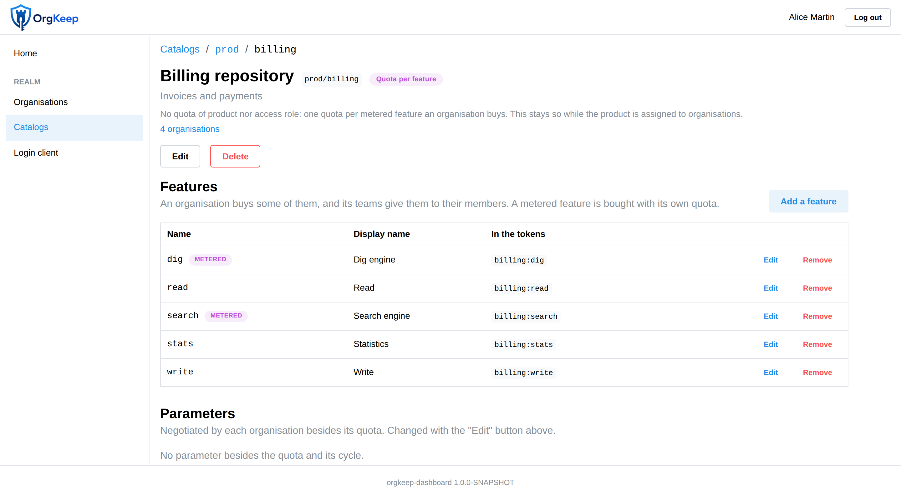
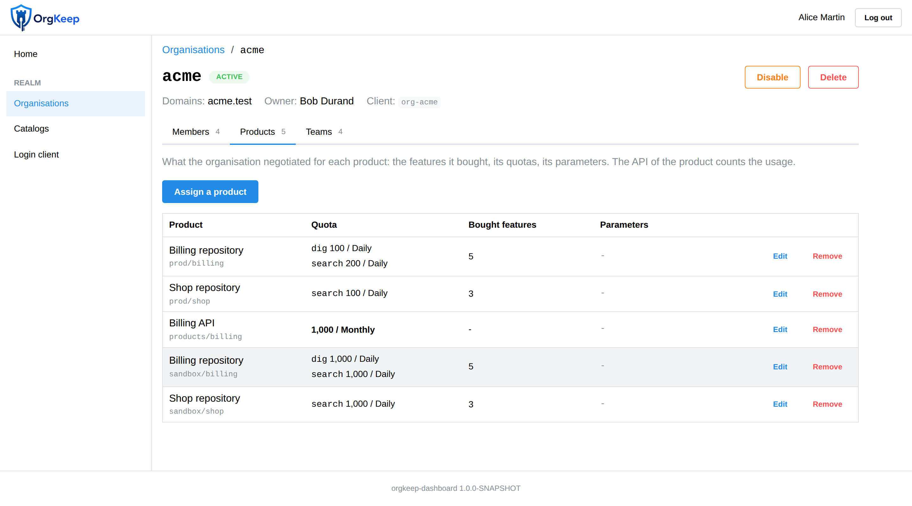

The realm owner describes what it sells in **catalogs**, and decides for each organisation what it bought by
**assigning** products to it. This page covers both. What an org admin then gives to its users is in
[Teams](../teams/), and the counters that come with a quota are in [Quotas and pools](../quotas/).

The examples use the demo data of `acme`:

| Catalog | Products | Meaning in the demo |
|---|---|---|
| `products` | `billing` (simple, no feature) | The default catalog, created with the realm |
| `prod` | `billing` and `shop`, with the metered feature `search` (and `dig` for `billing`) | The production environment |
| `sandbox` | the same two products | The test environment |

## Catalogs

A **catalog** is a Keycloak client (a container of roles, with no flow and no login) and a **client scope of the same
name**. The realm owner chooses the name with its own criterion: an environment (`prod`, `sandbox`), a region, an
offer. The name matters, because it is used in three places of the token:

- the key of the rights in the standard `resource_access` claim (`resource_access.prod`);
- the prefix of the claims that carry the quotas and parameters (`prod.billing.search`);
- the audience: the catalog is added to `aud` when the token carries one of its roles.

So a catalog name is a lowercase slug, which cannot clash with a claim of the token (`sub`, `scope`, `organization`...)
nor with an existing client, and cannot start with `org-`. The catalog `products` is created with the realm: a company
with no particular need has nothing to configure.

A catalog can be deleted when it holds no product and no catalog role. The client of a catalog is confidential: its
secret is what the APIs of the catalog use to introspect tokens (see [The token](../token/#lightweight-tokens)). The
realm owner gets a new secret with `POST /api/admin/catalogs/{catalog}/secret`; it is shown once and the old one stops
working.

### When a catalog is in a token

The scope of a catalog is an **optional** client scope of the realm. A token holds a catalog only if the client that
asked for it has the scope **by default**, or the application asks for it with `scope=<catalog>`. This keeps the token
small for a user who is in several catalogs, and gives each API only its own environment: a token asked with
`scope=prod` does not have `sandbox` in its audience, so the API of `sandbox` refuses it. The rules are detailed in
[The token](../token/#which-catalogs-are-in-the-token).

## Products

A **product** belongs to its catalog: the same name `billing` is created once in each catalog where it exists, and the
two are unrelated. A product is a **client role** of the catalog, with:

- a display name and a description;
- optional **features**;
- an optional schema of **parameters**.

The names of products and features are slugs. A product name never contains `:`, which is reserved for features.

### Simple and metered products

A product is of one of two kinds, deduced from its features (it is not a setting):

| | Simple product | Metered product |
|---|---|---|
| Features | none, or only permissions | at least one **metered** feature |
| Access role in the token | yes: the role `billing` | **no** |
| Quota | one quota for the product | **one quota per metered feature** bought, and none for the product |
| Example | `products/billing` | `prod/billing`, `prod/shop` |

A simple product is the plain case: an organisation has the product or not, with a quota of usage. A metered product
is for capabilities that are bought and counted separately: in the demo, `search` and `dig` are engines of a
repository, and an organisation buys a daily quota for each of them.

The kind of a product **cannot change while it is assigned to an organisation** (`409`): every assignment and every
team would have to switch from a quota of product to quotas of features. To change the kind, create `billing-v2`,
assign it, then unassign the old one: a user who refreshes a token in between never loses access. Adding a metered
feature to a product that already is metered is free, since no organisation has bought it yet.

### Features

A **feature** is a real client role named `<product>:<feature>`, so that it reaches the token natively as a role:
`billing:read`, `billing:search`. It is either:

- a **permission** (`read`, `write`, `stats`): it says what the user may do, and has no quota;
- a **metered feature** (`search`, `dig`): a capacity that an organisation buys with its own quota. The flag is chosen
  when the feature is created and does not change afterwards. A metered feature bought by an organisation cannot be
  deleted, since removing it would silently cut a negotiated capacity.

The names `params`, `options` and `quotas` are reserved and cannot be used for a feature.

A product without any feature is valid. The user simply has the product, and the catalog roles decide what it can do.

In the demo, `prod/billing` has the permissions `read`, `write`, `stats` and the metered features `search` and `dig`;
`prod/shop` has the same, without `dig`.

### Parameters

A product can declare a **schema of parameters**: values that each organisation negotiates in addition to its quotas
(a region, a number of seats...). Each parameter has:

- a name,
- a type: `number`, `string`, `enum` (with its list of values) or `boolean`,
- whether it is required, and optionally a default value.

The schema is on the product, the values are on the assignment to an organisation, and they reach the token typed
after the schema (a `number` is a JSON number). They exist at the level of the organisation only: a team cannot
override them. When the schema changes, the values of the organisations follow: a removed parameter disappears, a new
one takes its default, and the change is refused if an organisation would be left without a value for a required
parameter without a default.

The values of all the parameters of an organisation must fit in 255 characters once written as JSON (a limit of
Keycloak on group attributes), otherwise the assignment is refused with `400`.

## Catalog roles

Besides its products, a catalog has **catalog roles**: roles valid for every product of the catalog, and so for one
environment, not for one product. For instance `searcher` ("may search in all my products"), `beta-tester` or
`anonymous` (a test account excluded from the statistics). A right on a single product is a feature, not a catalog
role. The API of the realm owner combines the catalog roles with the products of the user.

Each catalog role is one of two kinds:

- **grantable by org admins**: an org admin gives it to its teams. Only in a catalog where the organisation has at
  least one product;
- **reserved to the realm owner**: only the realm owner gives it, directly to a user or to a service account, catalog
  by catalog. The demo has `anonymous` in `prod` and `sandbox`.

Catalog roles come out in `resource_access.<catalog>.roles`, next to the roles of the products.

## Assigning a product to an organisation

The realm owner **assigns** a product to an organisation: this is what the organisation bought. It is the only way an
organisation gets a product, there is no product given directly to a user. The assignment is written as the group
`/<org>/catalogs/<catalog>/<product>` (see [Organisations](../organisations/#what-an-organisation-looks-like-in-keycloak))
and holds what was negotiated:

- the **bought features**: the ceiling of the organisation. A team can only give features among those;
- the **quotas**, each with its **cycle**, `daily`, `monthly` or `yearly`. They are mandatory:
  - a simple product has **one quota**;
  - a metered product has **one quota per bought metered feature**, and at least one feature must be bought;
  - the catalog has no default quota;
- the **values of the parameters**, checked against the schema, with the defaults applied.

In the demo, `acme` bought:

| Product | Bought features | Quotas |
|---|---|---|
| `products/billing` | | 1000 / monthly |
| `prod/billing` | `read`, `write`, `stats`, `search`, `dig` | `search` 200 / daily, `dig` 100 / daily |
| `prod/shop` | `write`, `stats`, `search` | `search` 100 / daily |
| `sandbox/billing` | the same as in `prod` | `search` 1000 / daily, `dig` 1000 / daily |
| `sandbox/shop` | the same as in `prod` | `search` 1000 / daily |

Assigning again replaces everything that was negotiated: a metered feature that is no longer bought leaves with its
quota, and the teams that gave it are updated. Unassigning a product removes it from all the teams of the
organisation; removing the last product of an organisation in a catalog also removes the catalog roles of this
catalog from its teams. A product cannot be deleted while an organisation has it.

:::note
A change reaches the tokens at the next token issued, at the latest when the access token of the user expires
(5 minutes by default in Keycloak), and a refresh reads everything again.
:::

## The three levels

The model has three levels, all optional except the product and its quota:

1. **what the organisation bought**: the realm owner, with the assignments;
2. **which products a user has**: the org admin, with its [teams](../teams/);
3. **what a user may do in an environment**: the catalog roles.

A small company can use only the second: one catalog `products`, products without features, one team.
