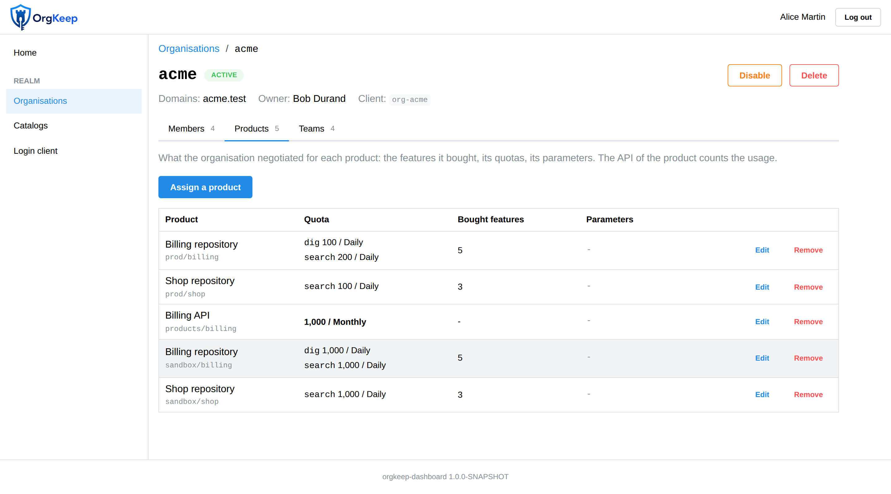

This page describes who does what in Orgkeep, and what an organisation is made of. The names used here (`acme`,
`org-owner`...) are those of the [demo stack](../../getting-started/).

## Realm owner and organisations

The **realm owner** is the company that runs the Keycloak realm and sells something to businesses: its customers are
the **organisations**. The realm owner creates one organisation per customer, decides which products each of them
bought (see [Catalogs, products and features](../catalogs/)), and can optionally name its first owner at creation.
The realm owner holds the realm role `realm-owner`, which opens the `/api/admin/...` part of the REST API and the
realm owner screens of the dashboard.

An organisation is a native Keycloak Organization, plus what Orgkeep adds around it. It is identified by its **name**,
a lowercase slug (letters, digits and dashes) that cannot change afterwards: `acme`. Its **domains** (`acme.test`) are
those Keycloak uses to recognise the organisation of a user at login.

Orgkeep works on a single realm, so the realm never appears in the path of the REST API: the realm owner endpoints are
under `/api/admin/...`, and those of an organisation under `/api/organisations/{org}/...`, where `{org}` is its name.



## One user, one organisation

A user belongs to **one organisation only**. The quotas in a token are not qualified by organisation (see
[The token](../token/)), so a user in two organisations would mix their pools.

Adding to an organisation a user who is already in another one is refused with `409`, and so is adding a user who
manages the realm (the realm owner, or anyone with a role of the Keycloak `realm-management` client). The message of
the refusal is the same for both cases on purpose: an org admin cannot learn who has rights on the realm, or who is the
customer of whom.

## The three roles of an organisation

Each organisation has a Keycloak client named `org-<org>` (`org-acme`). It is only a container of roles: nobody logs in
with it. It carries three **composite** roles:

| Role | Includes | Who |
|---|---|---|
| `org-owner` | `org-admin` | The owner named at creation. Given directly, never through a team. Cannot be removed or disabled |
| `org-admin` | `org-user` | Members of the predefined team `admin`: an org admin (or the realm owner) adds a member to this team and the member becomes an org admin |
| `org-user` | | Members of the predefined team `users`, that is every member |

Keycloak puts the effective roles in the token, so a check only asks for the lowest role that is enough: an org owner
passes every check that asks for `org-admin`.

What each role does:

- **org user**: logs in and gets the rights of its teams. Has no access to the management API.
- **org admin**: manages its own organisation through `/api/organisations/{org}/...`, and only that one: members,
  teams, service accounts. An org admin of `acme` can never reach another organisation. An org admin cannot change what
  the organisation bought: that is the realm owner's side.
- **org owner**: an org admin who cannot be removed or disabled, so that an organisation always keeps someone able to
  administer it.
- The realm owner can do everything an org admin does, in every organisation (the dashboard uses it to show the
  screens of an organisation without logging in again).

The demo has `org-owner` (owner of `acme`), `org-user` (a plain member) and the realm owner `realm-owner`.

## Members and invitations

An org admin adds a member with an email, a first name and a last name. If the email does not exist yet, Orgkeep
creates the user without a password and Keycloak sends an **invitation** email with a link to choose one (the SMTP
server is a setting of the realm, see the [configuration](../../reference/configuration/)). The link also verifies
the email. The list of members shows the invitations still pending, and an admin can send the email again with a new
link.

A new member is in the team `users` and has the role `org-user`. From the member list, an org admin can also:

- **disable** a member (an employee who left) without removing it, and enable it again. Disabling closes the sessions;
  an access token already issued stays valid until it expires, unless the API introspects it (see
  [The token](../token/#lightweight-tokens));
- **remove** a member, which takes it out of the organisation and of all its teams. The user itself is kept in the
  realm.

An admin cannot disable itself, nor the owner.

## Enabling and disabling an organisation

The realm owner can disable an organisation, for instance for a customer who does not pay anymore. Keycloak still lets
the members of a disabled organisation log in with their rights, so Orgkeep **also disables their accounts** and
closes their sessions. Enabling the organisation enables again exactly those members, not a user that was disabled for
another reason. Nobody can be added to a disabled organisation. Members who manage the realm are never disabled.

## Service accounts

An organisation gives machine access to the APIs of the realm owner (a batch, a backend, a CI job) with **service
accounts**. An org admin creates them, from the dashboard or with `POST /api/organisations/{org}/service-accounts`.
A service account is an OAuth2 confidential client named `org-<org>.<name>` (`org-acme.batch`) that uses the client
credentials flow. An org admin can:

- create it, with a description and the catalogs it gets **by default** in its tokens (only catalogs where the
  organisation has a product). The client id and the secret are shown once, with the URL of the token endpoint;
- rotate the secret (the old one stops working immediately);
- change its description and default catalogs, disable and enable it, delete it;
- put it in teams, so that it gets the rights of those teams (see [Teams](../teams/#teams-with-service-accounts)).

A service account is not a member: it does not appear in the member list nor in the member count, and its token holds
no role of the organisation, so it cannot call the management API. Where a person's token tells its organisation by the key
`org-acme` of `resource_access`, a service account's token carries the claim `organization: ["acme"]`, so that the
APIs of the realm owner can count per organisation either way (see [The token](../token/#a-service-account)).

Disabling a service account (or its organisation) stops it from getting new tokens, and an API that introspects its
tokens refuses the ones issued before. An API that only checks the signature of a token accepts it until it expires.

## What an organisation looks like in Keycloak

Everything is stored in Keycloak, Orgkeep has no database. For `acme`, the objects are:

- the Organization `acme`;
- the client `org-acme`, with the roles `org-owner`, `org-admin` and `org-user`;
- a tree of groups:

```
/acme
  /user-groups
    /admin           role org-admin
    /users           role org-user, every member is in it
    /sales           a team created by an org admin
    /accounting      another one
  /catalogs
    /prod
      /billing       the assignment of the product "billing" of the catalog "prod" to acme
      /shop
    /products
      /billing
  /service-accounts  the users of the service accounts of acme, no role
```

- `/acme/user-groups`: the **teams**. `admin` and `users` are predefined and cannot be deleted; the others are created
  by the org admins (see [Teams](../teams/));
- `/acme/catalogs/<catalog>/<product>`: one group per product the organisation bought, holding what it negotiated.
  Nobody is a member of these groups (see [Catalogs, products and features](../catalogs/#assigning-a-product-to-an-organisation));
- `/acme/service-accounts`: the proof that a service account belongs to the organisation, and the way to list them.

:::caution
These groups, and the roles of the catalogs, are meant to be changed through Orgkeep only. A change made by hand in
the Keycloak console is not seen by Orgkeep, and the rights it writes in the tokens can drift from what the dashboard
shows.
:::
