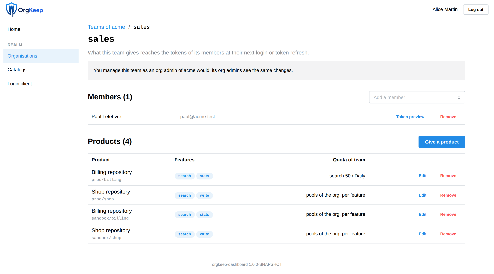

The realm owner decides what an organisation **bought**; the org admin decides **who gets what** among that, with
**teams**. A team is a group of the organisation that gives products and catalog roles to all its members.

## Teams of an organisation

The teams are the groups under `/<org>/user-groups`, in a flat list. A user can be in several teams. Two are
predefined and cannot be deleted:

- `admin`: its members are org admins (role `org-admin`, see [Organisations](../organisations/));
- `users`: every member of the organisation is in it, and cannot be taken out (role `org-user`).

The org admin creates the others: `sales`, `accounting`, one per application, whatever fits the organisation. Deleting
a team removes what it gave from its members.

To give something to **every** member, configure the team `users`: there is no separate notion of default role. In the
demo, `users` gives `products/billing`, which is why `org-user` gets it.

## What a team gives

An org admin gives a team two kinds of things.

### Products

A team gives a product that the organisation has bought, with:

- **its features**: by default all the features the organisation bought, including those it buys later. The org admin
  can list fewer; the list is then fixed, and always intersected with what the organisation bought. A feature that
  was not bought never reaches the token, whatever a team asks for;
- **a quota of team** (optional, see below).

How this works depends on the kind of product:

| | Simple product | Metered product |
|---|---|---|
| Features | any, **or none**: the user then has the product, and its catalog roles decide what it can do | **at least one** |
| Access role `billing` in the token | yes | no, only the features |
| Quota of team | one, optional, with its own cycle (by default the one of the organisation) | none for the product, but **one optional quota per metered feature given**, each with its own cycle (by default the one of the organisation for this feature) |

In the demo, the team `sales` of `acme` gives:

- in `prod`: `shop` with the features `write` and `search`, and `billing` with `stats` and `search`, with a team quota
  of 50 / daily on `search` of `billing`;
- in `sandbox`: the same, without a team quota.

The team `accounting` gives every feature of `billing`, which is `read`, `write`, `stats`, `search` and `dig` in both
catalogs.

A team can only give a product that the organisation has bought, and a quota of team can only be set on a feature that
the team gives and that is metered. Giving the product again replaces everything that was set for it on the team.

### Catalog roles

A team also gives **catalog roles** that the realm owner made grantable (`searcher`...), in a catalog where the
organisation has at least one product. They are independent of the products. A role reserved to the realm owner cannot
be given by a team.

## The quota of a team

Without a quota of team, a member of the team consumes the pool of the organisation, like everyone. With one, the team
gets **its own pool**: a budget shared by all its members, in addition to the pool of the organisation. Both limits
apply to each call. The size of the team quota is up to the org admin, and the sum of the quotas of the teams may
exceed the quota of the organisation: the pool of the organisation remains the real ceiling.

A quota of team is a ceiling for the team, not a reservation: it does not guarantee that the team can consume it if the
organisation has no room left. The pools and how an API counts them are in [Quotas and pools](../quotas/).

## Teams with service accounts

An org admin can put the [service accounts](../organisations/#service-accounts) of the organisation in teams, from the
page of the team. A service account in a team gets exactly the rights of a person of this team. It cannot be put in
`admin` nor in `users`: a service account never has a role of the organisation.

A team may mix people and service accounts, but **the pools of a team are shared by all its members**: if people use up
the quota of the team, the application stops. The advice is:

- **one team per application**, so that an application is not blocked by the people;
- **a quota of team on the teams of people**, to keep room for the applications.

For example, an organisation with a quota of 1000, a team of people capped at 700 and a team of the application with no
team quota: the application always keeps at least 300, since people cannot use more than 700 of the pool of the
organisation. The dashboard shows a warning on a mixed team, without blocking it.

## How the rights reach the token

Orgkeep calculates nothing when a token is issued, and writes nothing on the users for the teams (the exceptions are the catalog roles the realm owner grants directly to a
user, and the role `org-owner`). The rights are **written in advance
on the group of the team**, and the **native mappers of Keycloak** put them in the token:

- the **roles** (the product, its features, the catalog roles) are client role mappings of the team group, and come
  out in `resource_access`;
- the **quotas** and **parameters** are attributes of the team group, read by native attribute mappers into claims.

No Keycloak extension is needed, so Orgkeep works with any Keycloak 26, including one that you do not control. Every
change keeps the groups right at once:

- a team is updated when it changes;
- when the realm owner renegotiates an assignment (quotas, bought features, parameters), the teams of the organisation
  that give this product are updated;
- when a product is unassigned, a feature is deleted or no longer bought, or a catalog role is deleted or no longer
  grantable, it is removed from the teams.

A user in several teams receives the union of what they give: the roles of all its teams, and the pools of all its
teams (see [Quotas and pools](../quotas/#several-teams)). What a user gets is what is in the token, and the realm owner
can see it for any member with the **Token preview** of the dashboard (see [The token](../token/)).

:::caution
Because the rights are written on the groups, a change made by hand in the Keycloak console on a team of an
organisation is not seen by Orgkeep. Change teams through Orgkeep only.
:::
