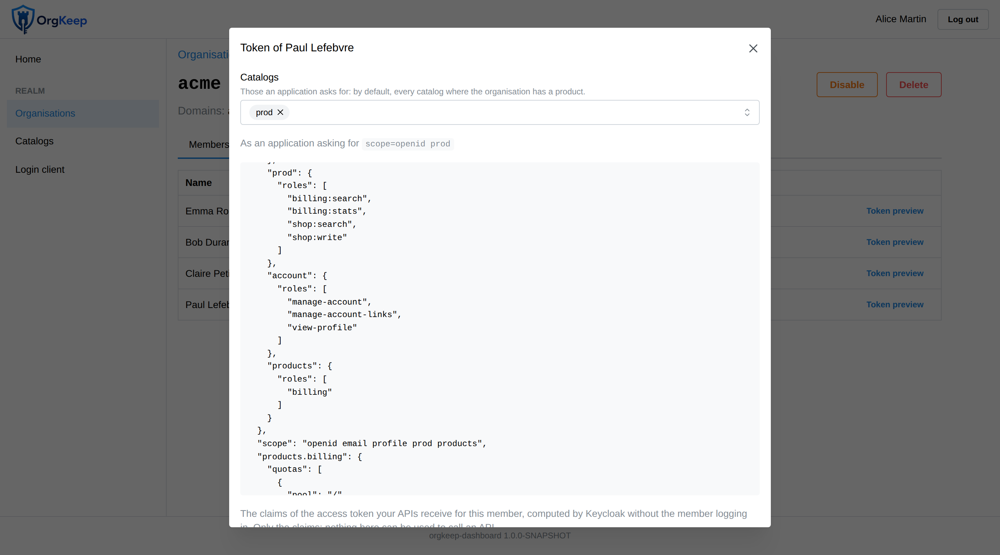

The access tokens that Orgkeep's users and service accounts get carry what their organisation bought and what their
teams give them. This page shows what that looks like, and how an API reads it. The examples are those of the
[demo stack](../../getting-started/), so you can reproduce them: the realm owner sees the claims that a member would
get with **Token preview** in the dashboard (the page of a member, or of a team).



## The shape of the token

The rights go in the **standard `resource_access` claim** of Keycloak, which libraries and API gateways already know how
to read, instead of a custom claim that every project of the realm owner would have to decode. The claims of a catalog
only carry what `resource_access` cannot say: the quotas and the parameters.

| What | Where | Example |
|---|---|---|
| The catalog | a key of `resource_access`, and an entry of `aud` | `resource_access.prod` |
| A catalog role | `resource_access.<catalog>.roles` | `searcher` |
| A simple product (access role) | `resource_access.<catalog>.roles` | `billing` |
| A feature | `resource_access.<catalog>.roles`, **prefixed by its product** | `billing:search` |
| Quotas and parameters of a simple product | the top-level claim `<catalog>.<product>` | `"prod.shop-repository"` |
| Quotas of a metered feature | the top-level claim `<catalog>.<product>.<feature>` | `"prod.billing.search"` |
| Parameters of a metered product | the top-level claim `<catalog>.<product>` | `"prod.billing"` |

A few rules:

- **The roles say what is allowed, the claim says how much.** Each counted thing is an object (`quotas`, `params`),
  never a bare array, so that keys can be added later without breaking the format.
- The claims are **flat**: the name `prod.billing.search` is one claim whose name contains dots, not three nested
  objects. An API reads the quotas of a call with a single `getClaim("prod.billing.search")`, and the quotas of a whole
  catalog by taking the claims whose name starts with `prod.`.
- `quotas` is always an array, even with one pool (see [Quotas and pools](../quotas/)).
- The order of the roles, and of the pools in a `quotas` array, is not guaranteed.
- A feature that is not metered (`billing:stats`) has no claim: its role is enough. A user who only has features without
  a quota has no quota claim for the product (if the product has parameters, `<catalog>.<product>` still holds
  `params`).
- The claims carry the names of the catalogs chosen by the realm owner, and nothing that names Orgkeep: the client of
  the organisation is `org-acme`, the catalogs are `prod`, `products`...
- Only the **access token** (and its introspection) carries them: neither the ID token nor the userinfo endpoint.

In every example below, the claims that Keycloak adds anyway (`iss`, `sub`, `exp`, `aud`, `scope`, the roles of the
client `account`...) are left out, only the claims that Orgkeep writes are kept.

## A simple product, the pool of the organisation only

`org-user`, a plain member of `acme`, with the default login: no `scope` asked. The team `users` gives the simple
product `billing` of the catalog `products`, which `acme` bought for 1000 a month. Every member of an organisation is in
`users`, so this is what a member gets when nobody configured anything else.

```json
{
  "resource_access": {
    "org-acme": { "roles": ["org-user"] },
    "products": { "roles": ["billing"] }
  },
  "products.billing": {
    "quotas": [
      { "pool": "/", "limit": 1000, "cycle": "monthly" }
    ]
  }
}
```

- `org-acme` is the client of the organisation: its roles are those of the member in its organisation (read by the
  management API of Orgkeep, see [Organisations](../organisations/)). A service account has none.
- `products` is a catalog the login client has **by default** (see [below](#which-catalogs-are-in-the-token)): that is
  why `scope=products` was not needed.
- `billing` is the access role of a simple product. `products.billing` has its quotas, with a single pool: `/`, the one
  of the organisation.

## The same product, with a team quota: two pools

Now the org admin gives the team `users` a quota of team of 300 for `billing` (cycle by default: the one of the
organisation, `monthly`). The same member now gets two pools:

```json
{
  "resource_access": {
    "org-acme": { "roles": ["org-user"] },
    "products": { "roles": ["billing"] }
  },
  "products.billing": {
    "quotas": [
      { "pool": "/",      "limit": 1000, "cycle": "monthly" },
      { "pool": "/users", "limit": 300,  "cycle": "monthly" }
    ]
  }
}
```

`/` is the pool of the organisation and `/users` the pool of the team. The API must count a call against both: see
[how an API counts](../quotas/#how-an-api-counts).

## A metered product: one pool per metered feature

`emma`, in the team `accounting` of `acme`, asking for the catalog `prod` (`scope=openid prod`). `acme` bought five
features of `prod/billing`, with `search` at 200 a day and `dig` at 100 a day, and `accounting` gives them all. Only the
parts of the token for `prod` are shown:

```json
{
  "resource_access": {
    "prod": {
      "roles": [
        "billing:dig",
        "billing:read",
        "billing:search",
        "billing:stats",
        "billing:write"
      ]
    }
  },
  "prod.billing.search": {
    "quotas": [
      { "pool": "/", "limit": 200, "cycle": "daily" }
    ]
  },
  "prod.billing.dig": {
    "quotas": [
      { "pool": "/", "limit": 100, "cycle": "daily" }
    ]
  }
}
```

- There is **no `billing` role**, only features: the API checks the feature a call needs (`billing:search`), an exact
  role that `@RolesAllowed` and similar annotations can test.
- `read`, `write` and `stats` are permissions: roles, no claim.
- `search` and `dig` are metered: each has its own claim and its own pool of the organisation, with its own limit and
  cycle. The counters are `(acme, prod, billing, search, /)` and `(acme, prod, billing, dig, /)`, independent.

## Several pools and several products: `paul`

`paul` is in the team `sales`, which gives `shop` (`write`, `search`) and `billing` (`stats`, `search`) in `prod`, with
a team quota of 50 a day on `search` of `billing`. He also is in the team `users`, which gives him `products/billing`.
Token asked with `scope=openid prod`:

```json
{
  "resource_access": {
    "org-acme": { "roles": ["org-user"] },
    "prod": {
      "roles": [
        "billing:search",
        "billing:stats",
        "shop:search",
        "shop:write"
      ]
    },
    "products": { "roles": ["billing"] }
  },
  "prod.billing.search": {
    "quotas": [
      { "pool": "/",      "limit": 200, "cycle": "daily" },
      { "pool": "/sales", "limit": 50,  "cycle": "daily" }
    ]
  },
  "prod.shop.search": {
    "quotas": [
      { "pool": "/", "limit": 100, "cycle": "daily" }
    ]
  },
  "products.billing": {
    "quotas": [
      { "pool": "/", "limit": 1000, "cycle": "monthly" }
    ]
  }
}
```

The same token has everything at once:

- two catalogs, `prod` (asked for) and `products` (a default one of the login client);
- two products of `prod`, so the features are prefixed (`billing:search`, `shop:search`);
- for `billing:search`, **two pools** (the organisation and the team `sales`), for `shop:search` **a single pool**: the
  team `sales` gives `shop` without a team quota;
- `billing:stats` and `shop:write` have no claim.

Compare with the real thing: ask for the token of `paul` as in [Getting started](../../getting-started/#first-steps), or
open his token preview.

## Several catalogs

With `scope=openid prod sandbox`, the token of `paul` has the two environments side by side. Only the `sandbox` part is
new (the larger quotas of the sandbox, and no team quota there):

```json
{
  "resource_access": {
    "prod": { "roles": ["billing:search", "billing:stats", "shop:search", "shop:write"] },
    "sandbox": { "roles": ["billing:search", "billing:stats", "shop:search", "shop:write"] }
  },
  "prod.billing.search": {
    "quotas": [
      { "pool": "/",      "limit": 200, "cycle": "daily" },
      { "pool": "/sales", "limit": 50,  "cycle": "daily" }
    ]
  },
  "prod.shop.search": {
    "quotas": [{ "pool": "/", "limit": 100, "cycle": "daily" }]
  },
  "sandbox.billing.search": {
    "quotas": [{ "pool": "/", "limit": 1000, "cycle": "daily" }]
  },
  "sandbox.shop.search": {
    "quotas": [{ "pool": "/", "limit": 1000, "cycle": "daily" }]
  }
}
```

`aud` has both `prod` and `sandbox`. The API of the `prod` environment reads only the claims that start with `prod.`
and `resource_access.prod`, and an API of `sandbox` refuses a token asked with `scope=openid prod`. The usual practice is
to ask for one catalog per API, which keeps tokens small: see [below](#which-catalogs-are-in-the-token).

## Parameters

When a product has a schema of parameters, the values negotiated by the organisation are in the claim of the product,
typed after the schema: a number is a JSON number, a boolean a JSON boolean. For a simple product, `params` is next to
`quotas`. Take a product `shop-repository` with the parameters `region` (an enum, `eu` or `us`) and `seats` (a number),
assigned to an organisation at 1000 a month, with a team `ops` that has a team quota of 300:

```json
{
  "resource_access": {
    "prod": { "roles": ["shop-repository"] }
  },
  "prod.shop-repository": {
    "params": { "region": "eu", "seats": 10 },
    "quotas": [
      { "pool": "/",    "limit": 1000, "cycle": "monthly" },
      { "pool": "/ops", "limit": 300,  "cycle": "monthly" }
    ]
  }
}
```

For a **metered** product the quotas are in the claims of its features, so `params` is alone in the claim of the
product:

```json
{
  "resource_access": {
    "prod": { "roles": ["billing:search"] }
  },
  "prod.billing": {
    "params": { "region": "eu" }
  },
  "prod.billing.search": {
    "quotas": [
      { "pool": "/", "limit": 200, "cycle": "daily" }
    ]
  }
}
```

The parameters are the same for every member of the organisation: a team cannot override them.

## A service account

The service account `batch` of `acme`, in a team that gives `prod/billing` with the feature `search` (the team `batch`,
without a team quota), asking for a token with the client credentials flow:

```
curl -s http://localhost:8280/realms/demo/protocol/openid-connect/token \
  -d grant_type=client_credentials -d client_id=org-acme.batch -d client_secret=<secret> -d scope=prod
```

The access token carries the identity of the client, the **organisation**, and the same rights and claims as a person
of this team:

```json
{
  "azp": "org-acme.batch",
  "client_id": "org-acme.batch",
  "organization": ["acme"],
  "resource_access": {
    "prod": { "roles": ["billing:search"] }
  },
  "prod.billing.search": {
    "quotas": [
      { "pool": "/", "limit": 200, "cycle": "daily" }
    ]
  }
}
```

- The claim `organization` is the native one of Keycloak, an array of the aliases of the organisation: it is what lets
  the API key its counters by organisation (see [Quotas and pools](../quotas/#the-key-of-a-counter)). A person's token
  has no such claim, its organisation is the key `org-acme` of `resource_access`.
- There is no role of the organisation (no `org-acme` in `resource_access`): a service account cannot call the
  management API of Orgkeep.
- A catalog role given directly by the realm owner (a reserved one such as `anonymous`) also comes out in
  `resource_access.<catalog>.roles`, for a service account as for a person.
- The `scope` works as for a user (see below), and the default catalogs of the service account are chosen by its org
  admin. A service account can only ask for the catalogs where its organisation has a product: a catalog becomes
  askable at the first product of the organisation in it.
- The realm owner can switch the tokens of a service account to lightweight tokens, see
  [Lightweight tokens](#lightweight-tokens).

## Which catalogs are in the token

Each catalog is an **optional client scope**: the token holds a catalog (`resource_access.<catalog>`, the claims
`<catalog>.*` and its entry in `aud`) only if:

- the client that asks has the scope of the catalog **by default**, or
- the application asks for it with `scope=<catalog>`.

For the **login client** of the realm (the one named after the realm, shared by all the organisations) the defaults are
chosen by the realm owner, on the **Login client** page of the dashboard. A new realm has `products` as the only default;
a new catalog is added as optional. A service account has the defaults that its org admin chose, among the catalogs
where the organisation has a product, and can ask for the others of those catalogs with `scope`. With no default at all, the application
has to ask for every catalog it needs.

On top of this:

- The clients that Orgkeep manages do not get every role of the user (`fullScopeAllowed` is off): the roles of a
  catalog are in the token only when its scope is.
- A catalog is in the token only if the user **has something in it**: a member in no team that gives a product of the
  catalog gets no `resource_access` entry for it, even when asking for its scope.
- Asking for the scope of a catalog where the organisation has nothing is not an error: Keycloak issues a token without
  that catalog.
- The scope is listed in the `scope` claim of the token, which is what lets the introspection compute the same claims.
- A user who is in several catalogs would otherwise grow every token. An API usually asks for its own catalog only, and
  a token asked with `scope=prod` has no `sandbox` in its audience.

## When the token changes

Everything is written in Keycloak when the realm owner or an org admin changes something, and read at the next token: a
change (a quota, a removed product, a member leaving a team) is visible at the next token issued, at the latest when the
access token expires (5 minutes by default in Keycloak). A refresh reads everything again. A realm owner who wants it
faster lowers the lifespan of the access token.

The same goes for a member or a service account that is disabled: no new token is issued, and the sessions are closed,
but a token already issued is accepted until it expires by an API that only checks its signature. An API that
**introspects** the token refuses it right away, see below.

## Lightweight tokens

A full token grows with the rights of the user. Orgkeep can instead issue **lightweight tokens**: a token of constant
size, with no roles, no catalogs, no profile, that the APIs of the realm owner exchange for the full content by
**introspection** (RFC 7662).

The realm owner turns this on for every API at once, with **Lightweight tokens** on the **Login client** page of the
dashboard (`lightweightTokens` in `PUT /api/admin/login-client`). It applies to the **tokens of the login client** (the
tokens of the users of the organisations): the tokens of the service accounts stay full unless the realm owner switches
them (see below), and the ones used to call the REST API of Orgkeep always stay full. Every API that receives user tokens must then introspect. A lightweight token carries the claim
`"lightweight": true`, a marker of Orgkeep, so that an API that receives both kinds introspects only the ones that
carry it. It keeps standard claims such as `iss`, `client_id`, `exp`, `iat` and `jti`, and the `scope` claim, but
neither `sub` nor `aud` (the API reads the subject from the introspection), no roles, no profile.

```json
{
  "iss": "http://localhost:8280/realms/demo",
  "client_id": "demo",
  "scope": "openid profile email prod",
  "lightweight": true
}
```

The tokens of a **service account** have their own switch, which only the realm owner changes: the **Lightweight
tokens** switch on the page of the service account in the dashboard (the name in the list of the service accounts of
the organisation), or `PUT /api/admin/organisations/{org}/service-accounts/{sa}/settings` with `lightweightTokens`. The
org admins neither see nor change it. The realm owner also sets a **default for the new service accounts**, in the
**Service accounts** section of the **Login client** page, or with `PUT /api/admin/service-accounts/settings`: it
applies to the service accounts created afterwards and leaves the existing ones unchanged. Once switched, the
tokens of a service account are lightweight like the users' ones, so the roles and the `organization` claim are only in the introspection.

The introspection answers with the claims computed from the current state of the session, not frozen at issue time, so
the rights are up to date, and a token is inactive after a logout (`"active": false`). For the token of a member of
`sales` asked with `scope=openid prod`, the answer has the same `resource_access` and catalog claims as the full token
of the previous sections (the claims of the other catalogs and the standard ones are left out), and no marker:

```json
{
  "active": true,
  "resource_access": {
    "org-acme": { "roles": ["org-user"] },
    "prod": { "roles": ["billing:search", "billing:stats", "shop:search", "shop:write"] }
  },
  "prod.billing.search": {
    "quotas": [
      { "pool": "/",      "limit": 200, "cycle": "daily" },
      { "pool": "/sales", "limit": 50,  "cycle": "daily" }
    ]
  }
}
```

Who introspects: **the client of the catalog**, a confidential client whose secret the realm owner generates with
`POST /api/admin/catalogs/{catalog}/secret`, together with the URL of the endpoint. The APIs of a catalog introspect
only the tokens of this catalog. In the demo, the secrets are fixed (`prod-demo-secret`, `sandbox-demo-secret`):

```
curl -s -u prod:prod-demo-secret \
  -d token=$TOKEN \
  http://localhost:8280/realms/demo/protocol/openid-connect/token/introspect
```

Good to know:

- A token without any role of the catalog (a user with nothing in it, or a token asked without its scope) has no
  catalog in its audience, so the introspection answers `"active": false` and the API should answer `401`.
- A gateway that introspects lightweight tokens and wants to pass a full token to the APIs behind it can send
  `Accept: application/jwt` with the introspection request: the answer then also has a `jwt` field, the **full token**,
  signed by Keycloak, that those APIs can verify offline with the keys of the realm (JWKS). Without the header, nothing
  changes. The demo has such a gateway, `gateway-go`.
- The REST API of Orgkeep itself refuses lightweight tokens with `401`, and expects a token of the client `orgkeep-api`.

The quotas and the parameters are not in the lightweight token, like the roles: an API that wants to be sure reads
everything at the introspection.
