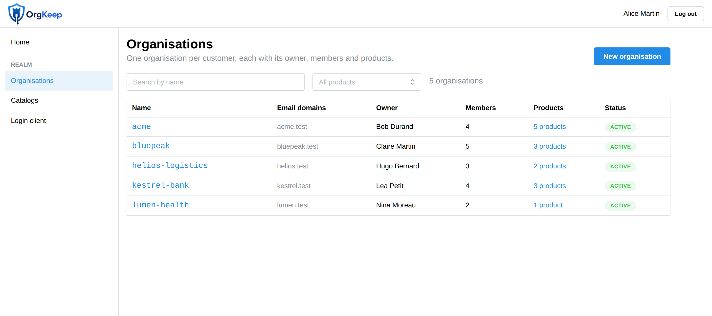
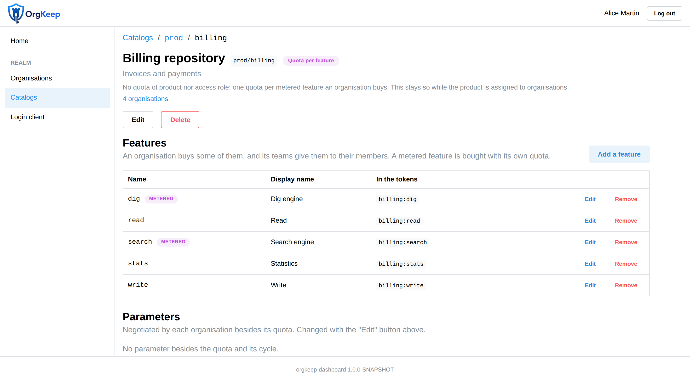

The quickest way to see Orgkeep working is the demo stack: Keycloak, PostgreSQL, Orgkeep (the dashboard and the REST
API), a mail catcher and three demo APIs, with demo organisations, accounts and catalogs. Nothing to build, only
[Docker](https://docs.docker.com/get-docker/) with Compose.

:::caution
This is a demo, not a production setup: fixed passwords and secrets, plain HTTP, Keycloak exposed directly.
:::

## Run the demo

The demo lives in the repository [orgkeep-examples](https://github.com/orgkeep/orgkeep-examples):

```
git clone https://github.com/orgkeep/orgkeep-examples.git
cd orgkeep-examples/docker-compose
docker compose up -d --build
```

The first start takes a minute or two: Keycloak creates its database, Orgkeep creates the realm and the demo data, and
the demo APIs are built from their sources. `docker compose ps` shows every service `healthy` or `running` once it is
ready.

Then open http://localhost:8284.

## What runs

| Service | URL | What it is |
|---|---|---|
| `orgkeep` | http://localhost:8284 | Orgkeep: the dashboard, the REST API under `/api`, Swagger UI under `/q/swagger-ui` |
| `keycloak` | http://localhost:8280 | Keycloak 26 with the Orgkeep theme. Admin console: `admin` / `admin` |
| `postgres` | (internal) | The database of Keycloak. Orgkeep itself has no database |
| `mailpit` | http://localhost:8025 | Catches every email of the realm (invitations, password resets) |
| `greetings-api-spring` | http://localhost:8290/greetings | A demo API of a realm owner, Spring Boot |
| `greetings-api-vertx` | http://localhost:8291/greetings | The same API in Vert.x |
| `gateway-go` | http://localhost:8292/greetings | A demo API gateway in Go, in front of `greetings-api-spring` |

## Demo accounts

The realm is `demo`, and every password is `password`.

| Account | Who | What to look at |
|---|---|---|
| `realm-owner` | The realm owner | The dashboard: organisations, catalogs, products, login client |
| `org-owner` | Owner of the organisation `acme` | The dashboard: members and teams of `acme` |
| `org-user` | A plain member of `acme` | Gets the product `billing` of the catalog `products` |
| `paul` | Member of the team `sales` of `acme` | Tokens for the demo APIs: catalogs `prod` and `sandbox` |
| `emma` | Member of the team `accounting` of `acme` | Every feature of `billing` |

## First steps

1. Log in to http://localhost:8284 as `realm-owner`. You see the organisations of the realm, here `acme`.

   

2. Open the **catalogs**: a catalog groups the products you sell, with their features and quotas. Open a product to
   see its features.

   

3. Open the organisation `acme` to see what it bought, its members and its teams. Log in as `org-owner` to see the
   same organisation as its org admin.
4. Invite a member from the dashboard, then open http://localhost:8025: the invitation email is there.
5. Ask for a token as `paul` and call a demo API with it:

   ```
   TOKEN=$(curl -s http://localhost:8280/realms/demo/protocol/openid-connect/token \
     -d grant_type=password -d client_id=demo -d username=paul -d password=password \
     -d "scope=openid prod" | jq -r .access_token)

   curl -s http://localhost:8290/greetings -H "Authorization: Bearer $TOKEN" | jq
   ```

   The answer shows the rights and the quotas of Paul in the catalog `prod`, as read from his token. The password
   grant is enabled for the demo only.
6. As `realm-owner`, open the **Login client** page and turn on **Lightweight tokens**. Ask for a new token and call
   again: the token is much smaller, and the API reads the same rights by introspection.

The REST API has its own documentation in Swagger UI, http://localhost:8284/q/swagger-ui (**Authorize** with
`realm-owner` / `password`), and its contract is at http://localhost:8284/q/openapi.

## Start over, or stop

```
docker compose down -v
```

`-v` also removes the volume of PostgreSQL: the next start creates a new realm with the demo data. Without it, the data
is kept between restarts.

## Next

- Every setting of the `orgkeep` service is in the [configuration reference](../reference/configuration/).
- The demo README in
  [orgkeep-examples](https://github.com/orgkeep/orgkeep-examples/tree/main/docker-compose) explains how the services
  are wired, and how to run unreleased images.
